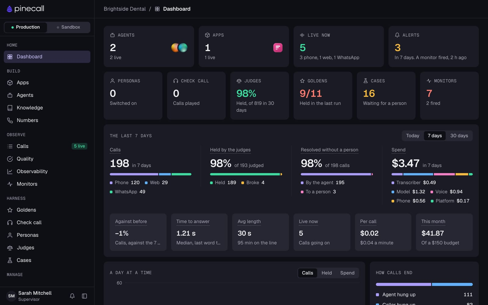
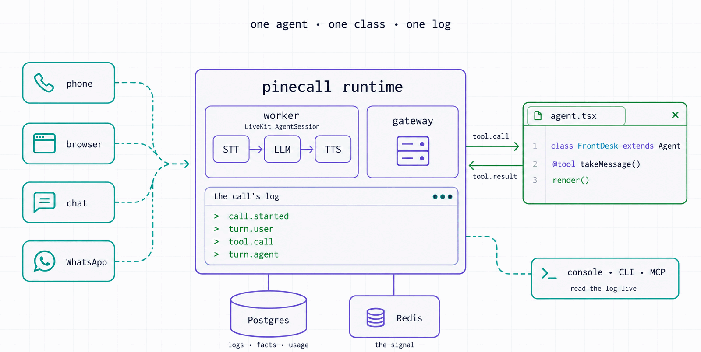

<p align="center">
  <a href="https://docs.pinecall.io/start/quickstart/">
    
  </a>
</p>

<p align="center">
  <a href="https://github.com/pinecall/pinecall/actions/workflows/check.yml"></a>
  <a href="https://github.com/pinecall/pinecall/tags"></a>
  <a href="https://www.npmjs.com/package/pinecall"></a>
  <a href="https://pypi.org/project/pinecall-runtime/"></a>
</p>

<p align="center">
  <a href="https://cloud.pinecall.io/sandbox/"><b>Open the console</b></a> ·
  <a href="https://docs.pinecall.io/start/quickstart/">Quickstart</a> ·
  <a href="https://docs.pinecall.io">Docs</a> ·
  <a href="https://docs.pinecall.io/guides/studio/">Studio</a> ·
  <a href="https://docs.pinecall.io/cli/overview/">CLI</a> ·
  <a href="https://docs.pinecall.io/mcp/overview/">MCP</a> ·
  <a href="https://docs.pinecall.io/self-hosting/overview/">Self-hosting</a>
</p>

<br>

**Pinecall is the open-source harness for voice AI.** Build a voice agent in a form, write a voice
app in code, or ask your coding assistant to do it. Put it on a phone number, a web page or
WhatsApp, test it before it goes live, and read every call it takes.

Pinecall takes care of the phone line, speech in and out, turn-taking, memory, retrieval, judges at
hang-up, the console and the bill. This repository holds all of it, and you can run it on your own
machine or use Pinecall Cloud.

<p align="center">
  <a href="https://cloud.pinecall.io/sandbox/"></a>
</p>

## ▸ Four ways in, one platform

| | you work in | best when |
|---|---|---|
| **[Agent Studio](#-agent-studio-no-code)** | the console: a form and a live chat | the agent is instructions, a few API calls and some data to collect |
| **[A voice app](#-a-voice-app-all-the-code-you-want)** | your editor, in TypeScript, Python or Ruby | it has logic of its own: stages, state, tools in your code |
| **[The CLI](#-the-cli-the-whole-platform-from-a-terminal)** | a terminal or a CI job | you want it scripted: tests, deploys, numbers, settings |
| **[MCP](#-mcp-let-your-assistant-build-it)** | Claude Code, Codex, Cursor and others | you would rather say what you want and watch it get built |

They are not separate products. Every agent, however it was made, runs on the same runtime, takes
the same calls, is tested the same way and shows up in the same console. A Studio agent can leave
the form whenever it outgrows it: `pinecall studio code` turns it into a TypeScript project.

## ▸ Agent Studio: no code

Open the [sandbox's Agents](https://cloud.pinecall.io/sandbox/agents), press **New**, and you are
talking to your agent a minute later. There is nothing to install and nothing to host.

- **Instructions**, with the call's own values filled in: `{{call.from}}`, `{{caller.name}}`, `{{call.today}}`.
- **A greeting**: a set line, an instruction the model opens with, or the caller speaks first.
- **Tools**: HTTP requests to your API that the model may make, each one tried from the page. A
  secret is named as `{{secrets.AGENDA_KEY}}`, never written in the form.
- **Data collection**: fields gathered from the caller and posted where you say when the call ends.
- **A voice, a knowledge base, a phone number**, in tabs of the same page, with **Talk** always one
  click away, as a chat or as a call.

Every save is a numbered release. The sandbox is where you build; **Deploy** copies a release to
production, where your callers reach it. The same agent can be driven from a terminal:

```console
$ pinecall studio new front-desk
$ pinecall studio pull front-desk            # the definition, as a file you can review
$ pinecall studio push front-desk --note "books the visit"
$ pinecall chat front-desk                   # nothing to start: Pinecall holds it
$ pinecall studio deploy front-desk
```

[Studio, field by field](https://docs.pinecall.io/guides/studio/)

## ▸ A voice app: all the code you want

A voice app is code in your repository: an `app.ts` that says which number is answered by whom, and a class per
agent. `@agent({ … })` says what the agent is; the class's fields are the call's state, its `@tool` methods are
what the model may do, and its docstrings and `render()` are the prompt.

```tsx
// agents/front-desk/agent.tsx
import { Agent, agent, tool, type Call } from "@pinecall/agents";

/**
 * You are the front desk of Brightside Dental. You book, move and explain visits.
 * Short sentences. Offer at most two times. Never say a time the agenda did not give you.
 */
@agent({
  stt: "deepgram/flux",                              // what it hears, thinks and speaks with
  llm: "google/gemini-3.5-flash-lite",
  voice: "cartesia/katie",
  takes: "booking, moving or asking about a visit",   // what a teammate may pass it
  judges: ["consent", "grounded", offersARealTime],   // who reads every call: Pinecall's, and its own
  personas: [hurried, chargedTwice],                  // the test callers that phone it
})
export default class FrontDesk extends Agent {
  slots: Slot[] = [];                                 // state: plain fields, kept per call

  override onCall(call: Call) {
    this.call.shared["patient"] = clinic.patientByPhone(call.contact);
  }

  /** The open times of one day. `day` is YYYY-MM-DD. */
  @tool({ announce: "Let me check the agenda." })     // a verb the model may call
  freeSlots(day: string) {
    return (this.slots = clinic.free(day));
  }

  /** Book one of the times freeSlots returned, once the caller said yes to it. */
  @tool()
  book(day: string, time: string, name: string) {
    const visit = clinic.book(day, time, name);
    this.log("visit.booked", { ...visit, phone: this.call.contact });   // the app hears it, below
    return visit;
  }

  override render() {                                 // the prompt's last block, a function of state
    if (this.slots.length === 0) return null;
    return <p>Offer only these times: {this.slots.map((slot) => slot.time).join(", ")}.</p>;
  }
}
```

```ts
// app.ts
import { flow, voiceApp } from "@pinecall/agents";

const app = voiceApp("brightside", { timezone: "America/Los_Angeles" });

// One number and a team behind it: the front desk answers, and the call may pass to billing.
app.line("+1 415 555 0134", { greeting: "Brightside Dental. How can I help?", answers: FrontDesk, team: [Billing] });
app.rule("Never say an amount of money that a tool did not give you.");

// A flow outlives the call that started it: the day before the visit, the agent calls the patient.
const remindVisit = flow("remind-visit", async (visit, step) => {
  await step.sleepUntil(startsAt(visit), { before: "24h" });
  await step.call(visit.phone, FrontDesk, { instruction: `Remind ${visit.patient} of the visit.` });
});
app.on("visit.booked", remindVisit);

export default app;
```

<details>
<summary><b>An agent in Python</b></summary>

```python
from typing import Literal

from pinecall import Agent, tool


class FrontDesk(Agent):
    """You answer the phone for the business as its automated assistant, and your first sentence says so.
    Short sentences: everything you say is read aloud.
    """

    stage: Literal["ask", "done"] = "ask"
    message: dict[str, str] | None = None

    @tool(stage="ask", pii=("name",))
    def take_message(self, name: str, about: str) -> dict[str, str]:
        """Writes down the caller's message, once they have said their name and what it is about."""
        self.message = {"name": name, "about": about}
        self.stage = "done"
        return self.message
```

</details>

<details>
<summary><b>An agent in Ruby</b></summary>

```ruby
require "pinecall"

# You answer the phone for the business as its automated assistant, and your first sentence says so.
# Short sentences: everything you say is read aloud.
class FrontDesk < Pinecall::Agent
  stage :ask, :done
  state :message

  # Writes down the caller's message, once they have said their name and what it is about.
  tool stage: :ask, pii: %i[name]
  def take_message(name:, about:)
    self.message = { name:, about: }
    self.stage = :done
    message
  end
end
```

</details>

What the agent runs on — its voice, its models, its greeting, the documents it searches — is declared with
the class, and an app written as code is set by its code: the console shows it, read-only. An agent built in
Studio has no code, and there the same settings are tuned in the console, per environment and versioned.

From an empty folder to a call:

```console
$ npm i -g pinecall
$ pinecall login                              # or run the runtime yourself, below
$ pinecall new acme --agent front-desk        # --python or --ruby for the other SDKs
$ cd acme && npm install
$ pinecall chat                               # a written call against your class, here
$ pinecall test                               # the goldens, judged by a model
$ pinecall start                              # hold the agent: the console's calls reach your process
$ pinecall deploy up                          # run it on the runtime, without your laptop
```

## ▸ The CLI: the whole platform from a terminal

One `pinecall`, the same for every language. What the console can do, a script can do.

| stage | verbs |
|---|---|
| start | `login` · `new` · `generate` · `whoami` |
| hold and talk | `start` · `chat` · `prompt` · `console` · `supervise` |
| Agent Studio | `studio new` · `pull` · `push` · `try` · `deploy` · `code` |
| the agent's settings | `agent` · `lexicon` · `voices` · `pipeline` · `providers` |
| testing | `test` · `simulate` · `eval` · `runs` · `cases` · `personas` · `judges` · `judging` |
| knowledge and memory | `docs` · `memory` · `remember` |
| the phone | `numbers` · `carriers` · `line` · `callbacks` |
| production | `deploy` · `secrets` · `sessions` · `monitors` · `webhook` · `telemetry` · `limits` · `data` |
| assistants | `mcp` · `mcp install` |

`pinecall <verb> --help` explains each one with examples, and the
[CLI reference](https://docs.pinecall.io/cli/overview/) has a page per verb.

## ▸ MCP: let your assistant build it

`pinecall mcp` is the same CLI as an [MCP](https://modelcontextprotocol.io) server. One command adds
it to Claude Code, Claude Desktop, Codex, Cursor, Windsurf, Antigravity and Gemini CLI:

```console
$ npm i -g pinecall
$ pinecall mcp install
```

Then ask for what you want. Your assistant has the whole journey as tools: make a project, write the
agent, hold it while it changes, chat with it, run its goldens, play a caller against it, read a
call, buy a number, and deploy.

> *"Make me a front-desk agent for a dental clinic that takes messages, test it with an impatient
> caller, and tell me what went wrong."*

Every tool acts in the sandbox unless it is asked for production, and your org's switch still
decides whether it may. No tool takes or returns a key. What cannot be undone (erasing data, dropping
a number, removing a deployed app) is not a tool at all: those stay commands a person types.

[The MCP server](https://docs.pinecall.io/mcp/overview/)

## ▸ The console

Every org gets one page with both worlds in it: a **sandbox**, where nothing reaches a real caller,
and **production**. It is where a team that does not write code lives.

| | |
|---|---|
| **Build** | Agents and Apps, each with its configuration, knowledge, tools, channels and tests. Numbers, with a test line to try one before buying |
| **Observe** | Calls live and past, each with its transcript, tools, latency and cost. Quality, Observability, and Monitors with alerts per agent |
| **Harness** | Goldens, Simulations, Personas, Judges, and Cases: a call that broke, kept until it is fixed |
| **Manage** | Team, Usage, Billing, Privacy, Settings |
| **Talk** | A side panel on every page: chat with the agent, or call it from the browser |

A supervisor can listen to a live call, whisper to the agent, take the line and hand it back.

[A tour of the console](https://docs.pinecall.io/guides/console/)

## ▸ Test it like software

| ring | what runs | how |
|---|---|---|
| `0` | the class as plain code: tools, state, the prompt, no network | `npm test` |
| `1` | goldens: a conversation the model must hold, judged turn by turn | `pinecall test`, or the agent's Test tab |
| `2` | a persona calls the agent over a real line, scored at hang-up | `pinecall simulate --voice`, or Simulations |
| `3` | one real call re-checked: latency, errors, consent, talk share | `pinecall eval <call>` |
| `4` | every finished call, judged at hang-up: the verdict is an entry in its log | nothing to run |

A broken call becomes a **case**: kept, fixed, then approved or dismissed. Judges, monitors and
alerts watch production.

## ▸ Your machine or Pinecall Cloud

The runtime is open source, and the agent is the same either way.

<table>
<tr><th>on your machine</th><th>on Pinecall Cloud</th></tr>
<tr><td>

```console
$ uv tool install "pinecall-runtime[voice]"
$ pinecall-runtime setup
```

Reads your machine and runs the stack that fits it, and asks your email and a password for the
console. No account, and no `login`.
[On your machine](https://docs.pinecall.io/self-hosting/laptop/)

</td><td>

```console
$ pinecall login
```

Signs this machine in through the browser, once. Or
[open the console](https://cloud.pinecall.io/sandbox/) and start in Studio, with nothing installed.

</td></tr>
</table>

## ▸ How a call moves

<p align="center">
  <picture>
    <source media="(prefers-color-scheme: dark)" srcset=".github/assets/how-it-works-dark-f48f3042.png">
    
  </picture>
</p>

1. **A caller comes in** by a carrier, the browser widget, a written chat or WhatsApp.
2. **A worker takes the call.** It runs LiveKit's `AgentSession`, with speech-to-text, the model
   and text-to-speech built from the org's providers.
3. **The agent acts.** A class's tool runs in your own process, asked over its app socket. A Studio
   tool is an HTTP request the gateway makes to your API.
4. **Everything is an entry in the call's log.** Turns, tool calls, latencies, costs and scores are
   appended, never rewritten. The console, the CLI, the MCP server, the bill and the judges all read
   that log.

The runtime is one Python package shaped like a Rails app.
[The architecture page](https://docs.pinecall.io/self-hosting/architecture/) walks every folder.

## ▸ Many orgs, one runtime

One runtime serves many businesses, and each one is an **org**: its own people and roles, keys,
numbers and carriers, vendor keys, quotas, usage and data.

- **Your code never runs inside the runtime.** A class runs in the org's own process, or in a
  gVisor-sandboxed pod of its own when the runtime hosts it. No two orgs' code share a process.
- **The database holds the line.** Every request is scoped to its key's org, and Postgres row-level
  security shows each connection that org's rows alone, a query that forgot its `WHERE` included.
- **Two environments per org.** The sandbox and production share the gateway and the database, never
  the workers. In the sandbox every person gets a copy of the agents of their own.
- **Settings live per org, per environment, versioned.** Quotas say what an org may use, and an org
  may bring its own vendor keys.

Pinecall stands on LiveKit: its media server, its SIP bridge and its Agents framework. It adds the
platform around them. [Orgs, keys and the two environments](https://docs.pinecall.io/self-hosting/multi-tenancy/)
has the whole model.

## ▸ What is inside

| folder | what it is | published as |
|---|---|---|
| [`runtime/`](runtime) | the gateway that answers every door of the API, and the worker that runs the calls on LiveKit | [`pinecall-runtime`](https://pypi.org/project/pinecall-runtime/) · PyPI |
| [`cli/`](cli) | the `pinecall` CLI and its MCP server, the same for every language | [`pinecall`](https://www.npmjs.com/package/pinecall) · npm |
| [`console/`](console) | the page the gateway serves, both environments in it, Agent Studio included | inside `pinecall-runtime` |
| [`widget/`](widget) | one agent as one button on any page | inside `pinecall-runtime` |
| [`sdk/typescript/`](sdk/typescript) | the TypeScript framework an agent is written in | [`@pinecall/agents`](https://www.npmjs.com/package/@pinecall/agents) · npm |
| [`sdk/python/`](sdk/python) | the Python SDK | [`pinecall`](https://pypi.org/project/pinecall/) · PyPI |
| [`sdk/ruby/`](sdk/ruby) | the Ruby SDK | [`pinecall`](https://rubygems.org/gems/pinecall) · RubyGems |
| [`packages/room/`](packages/room) | the caller's side of a call, for a page's own UI | [`@pinecall/room`](https://www.npmjs.com/package/@pinecall/room) · npm |
| [`packages/dot/`](packages/dot) | the talking dot, and the tutor that walks a page with a pointer of its own | [`@pinecall/dot`](https://www.npmjs.com/package/@pinecall/dot) · npm |
| [`packages/core/`](packages/core) | what the console and Pinecall's supervisor app stand on | taken as source |
| [`examples/`](examples) | Clínica Norte, the one example agent, in each language, and Brightside, the dot tutor's | read and copied, never published |
| [`infra/`](infra) | the charts, the images and the Terraform a runtime is deployed with | `make deploy` from `runtime/` |

## ▸ Contributing

```console
$ git clone https://github.com/pinecall/pinecall && cd pinecall
$ pnpm install          # every TypeScript package, one workspace and one lockfile (Node 24, pnpm 11)
$ cd runtime && uv sync # each Python package is a project of its own, with its own uv.lock
```

Each package's own check is what CI runs for it, only when its folder changed. Every published
package carries the same version, and a `v*` tag publishes them all. Report a vulnerability as
[SECURITY.md](SECURITY.md) says.

<br>

<p align="center">
  <sub><code>$ pinecall --help</code> · <a href="https://docs.pinecall.io">docs.pinecall.io</a> · <a href="https://pinecall.io">pinecall.io</a></sub>
</p>
