<p align="center">
  <a href="https://docs.pinecall.io/start/quickstart/">
    
  </a>
</p>

<p align="center">
  <a href="https://github.com/pinecall/pinecall/actions/workflows/check.yml"></a>
  <a href="https://github.com/pinecall/pinecall/tags"></a>
  <a href="https://www.npmjs.com/package/pinecall"></a>
  <a href="https://pypi.org/project/pinecall-runtime/"></a>
</p>

<p align="center">
  <a href="https://docs.pinecall.io/start/quickstart/"><b>Quickstart</b></a> ·
  <a href="https://docs.pinecall.io">Docs</a> ·
  <a href="https://docs.pinecall.io/cli/overview/">CLI</a> ·
  <a href="https://docs.pinecall.io/self-hosting/overview/">Self-hosting</a> ·
  <a href="https://docs.pinecall.io/api/gateway/">Gateway API</a> ·
  <a href="https://cloud.pinecall.io/sandbox/">Console</a>
</p>

<br>

**Pinecall runs voice and chat agents that you write as a class.** The class's fields are the
call's state, its `@tool` methods are what the model may do, and its docstrings and `render()` are
the prompt. Everything else is Pinecall's job: the phone line, the browser call, WhatsApp, speech
in and out, turn-taking, memory, retrieval, judges at hang-up, the console and the bill.

This repository holds all of it: the runtime that runs the calls, the console it serves, the SDKs
an agent is written with, and the CLI that drives them. Every package is released together, at one
version, by one tag.

## ▸ The agent is a class

```tsx
import { Agent, tool, type Stages } from "@pinecall/agents";

/**
 * You answer the phone for the business. Short sentences: everything you say is read aloud.
 * For anything the documents do not answer you take a message: who is calling and what about.
 */
export default class FrontDesk extends Agent {
  stage: Stages<"ask" | "done"> = "ask";          // state: plain fields, kept per call
  message?: { name: string; about: string } | undefined;

  /** Writes down the caller's message, once they have said their name and what it is about. */
  @tool({ stage: "ask", pii: ["name"] })           // a verb the model may call, in this stage
  async takeMessage(name: string, about: string) {
    this.message = { name, about };
    this.stage = "done";
    return this.message;
  }

  override render() {                               // the prompt's last block, a function of state
    return this.message
      ? <p>The message is written down: {this.message.name}. Say goodbye and hang up.</p>
      : <p>Greet the caller, and ask for their name and what the call is about.</p>;
  }
}
```

<details>
<summary><b>The same agent in Python</b></summary>

```python
from typing import Literal

from pinecall import Agent, tool


class FrontDesk(Agent):
    """You answer the phone for the business. Short sentences: everything you say is read aloud."""

    stage: Literal["ask", "done"] = "ask"
    message: dict[str, str] | None = None

    @tool(stage="ask", pii=("name",))
    def take_message(self, name: str, about: str) -> dict[str, str]:
        """Writes down the caller's message, once they have said their name and what it is about."""
        self.message = {"name": name, "about": about}
        self.stage = "done"
        return self.message
```

</details>

<details>
<summary><b>The same agent in Ruby</b></summary>

```ruby
require "pinecall"

# You answer the phone for the business. Short sentences: everything you say is read aloud.
class FrontDesk < Pinecall::Agent
  stage :ask, :done
  state :message

  # Writes down the caller's message, once they have said their name and what it is about.
  tool stage: :ask, pii: %i[name]
  def take_message(name:, about:)
    self.message = { name:, about: }
    self.stage = :done
    message
  end
end
```

</details>

The voice, the model, the greeting, the words it must pronounce and the documents it searches are
not in the class. They are settings of the agent, per environment and versioned, set with
`pinecall agent set` or in the console.

## ▸ From an empty folder to a phone call

The runtime is open source. Run it on your own machine, with no account, no vendor and nothing
sent to a cloud, or skip it and use Pinecall Cloud. The agent is the same either way.

### On your machine: `pinecall-runtime setup`

```console
$ uv tool install "pinecall-runtime[voice]"
$ pinecall-runtime setup
docker     compose 2.39.1
services   Postgres :55433 · Redis :56380 · LiveKit :7880
schema     at this release
console sign-in: your email: you@acme.dev
password:
Repeat for confirmation:
console    you@acme.dev signs in with the password typed
key        this machine's, in ~/.pinecall/local.json: the CLI finds this runtime by itself
models: local (open models on this machine, no account, ~4 GB pulled once) · keys (your vendors' keys) · none [local]: local
models     Ollama :11434 (qwen3:4b, bge-m3) · Whisper :8000 · Kokoro :8880 — open models, no account
row        the providers row written: the console edits it from now on
ready      console http://127.0.0.1:8080/sandbox/
```

One verb, run once and safe to run again. It needs Docker, and asks two things:

| it asks | what it does with it |
|---|---|
| **who signs in to the console**, and a password typed twice | makes you the admin of the org `default`, and hands your key to the `pinecall` CLI: no `login`, no `link` |
| **where the models come from** | `local`: Ollama thinks, Whisper hears, Kokoro speaks, bge-m3 embeds memory and documents, all on your machine. `keys`: your vendors' keys (`OPENAI_API_KEY` or `ANTHROPIC_API_KEY`, `DEEPGRAM_API_KEY`, `CARTESIA_API_KEY`), read from the environment or asked |

`--yes` asks nothing: local models, and a password drawn and shown once. `--chat-only` runs
written calls alone, with no LiveKit and no voice, the cheapest first run. `--org` makes a team's
runtime instead of one person's. `pinecall team password <email>` changes anyone's password later.
[On your machine](https://docs.pinecall.io/self-hosting/laptop/) walks every line.

### On Pinecall Cloud

```console
$ pinecall login
```

The runtime is already running at `cloud.pinecall.io`. Your org gets a sandbox, where nothing
reaches a real caller, and production. In a project, `pinecall link` writes its key to `.env`.

### Then, in either case

```console
$ npm i -g pinecall
$ pinecall new acme --agent front-desk        # --python or --ruby for the other SDKs
$ cd acme && npm install
$ pinecall prompt                             # the exact prompt the model will read, offline
$ pinecall chat                               # a written call against your class, here
$ pinecall start                              # hold the agent: the console's calls reach your process
$ pinecall test                               # the goldens, judged by a model
$ pinecall deploy up                          # run it on the runtime, without your laptop
```

`pinecall whoami` says which runtime and which key the folder acts on. Everything acts in the
**sandbox** first; `--prod` acts in production for one command.

## ▸ How a call moves

<p align="center">
  <picture>
    <source media="(prefers-color-scheme: dark)" srcset=".github/assets/how-it-works-dark-f48f3042.png">
    
  </picture>
</p>

1. **A caller comes in** by a carrier, the browser widget, a written chat or WhatsApp.
2. **A worker takes the call.** It runs LiveKit's `AgentSession`, with speech-to-text, the model
   and text-to-speech built from the org's providers.
3. **The gateway asks your class to act.** When the model calls a tool, the gateway sends
   `tool.call` down your process's app socket, and your method's answer comes back as
   `tool.result`.
4. **Everything is an entry in the call's log.** Turns, tool calls, latencies, costs and scores are
   appended, never rewritten. The console, the CLI, the bill and the judges all read that log.

The runtime is one Python package shaped like a Rails app. Each domain has its models, schemas,
repository, service and endpoints, in a fixed bottom-up order that a test enforces. The
[architecture page](https://docs.pinecall.io/self-hosting/architecture/) walks every folder.

## ▸ Many orgs, one runtime

One runtime serves many businesses, and each one is an **org**: its own people and roles, keys,
numbers and carriers, vendor keys, quotas, usage and data. Each org writes its own agents as
classes, in its own repository, and each agent is a folder with its tests beside it.

- **Your code never runs inside the runtime.** The worker runs the speech pipeline; the class runs
  in the org's own process, or in a gVisor-sandboxed pod of its own when the runtime hosts it, and the gateway asks it
  to act over its app socket. One shared fleet of workers serves every org, and no two orgs' code
  share a process.
- **The database holds the line.** Every request is scoped to its key's org, and Postgres
  row-level security shows each connection that org's rows alone, a query that forgot its `WHERE`
  included.
- **Two environments per org.** The sandbox and production share the gateway and the database,
  never the workers: each has its own fleet. In the sandbox every person gets a copy of the agents
  of their own.
- **Settings live per org, per environment, versioned.** The voice, the model, the greeting, the
  lexicon, what the agent knows and remembers, its numbers and its routes. Quotas say what an org
  may use, and an org may bring its own vendor keys.

Pinecall stands on LiveKit: its media server, its SIP bridge and its Agents framework, whose
`AgentSession` runs every call. In that framework the agent's code runs inside the worker. Pinecall
adds the platform around it: the orgs, the people and their keys, the agent's code kept in the
tenant's process, the settings, the log, the judges, the console and the bill.
[Orgs, keys and the two environments](https://docs.pinecall.io/self-hosting/multi-tenancy/) has
the whole model.

## ▸ Test it like software

| ring | what runs | command |
|---|---|---|
| `0` | the class as plain code: tools, state, the prompt, no network | `npm test` |
| `1` | goldens: a conversation the model must hold, judged turn by turn | `pinecall test` |
| `2` | a persona calls the agent over a real line, scored at hang-up | `pinecall simulate --voice` |
| `3` | one real call re-checked: latency, errors, consent, talk share | `pinecall eval <call>` |
| `4` | every finished call, judged at hang-up: the verdict is an entry in its log | nothing to run |

A broken call becomes a **case**: kept, fixed, then approved or dismissed (`pinecall cases`).
Judges, monitors and alerts watch production (`pinecall judges`, `pinecall monitors`).

## ▸ What is inside

| folder | what it is | published as |
|---|---|---|
| [`runtime/`](runtime) | the gateway that answers every door of the API, and the worker that runs the calls on LiveKit | [`pinecall-runtime`](https://pypi.org/project/pinecall-runtime/) · PyPI |
| [`cli/`](cli) | the `pinecall` CLI and its MCP server, the same for every language | [`pinecall`](https://www.npmjs.com/package/pinecall) · npm |
| [`console/`](console) | the page the gateway serves, both environments in it | inside `pinecall-runtime` |
| [`widget/`](widget) | one agent as one button on any page | inside `pinecall-runtime` |
| [`sdk/typescript/`](sdk/typescript) | the TypeScript framework an agent is written in | [`@pinecall/agents`](https://www.npmjs.com/package/@pinecall/agents) · npm |
| [`sdk/python/`](sdk/python) | the Python SDK | [`pinecall`](https://pypi.org/project/pinecall/) · PyPI |
| [`sdk/ruby/`](sdk/ruby) | the Ruby SDK | [`pinecall`](https://rubygems.org/gems/pinecall) · RubyGems |
| [`packages/room/`](packages/room) | the caller's side of a call, for a page's own UI | [`@pinecall/room`](https://www.npmjs.com/package/@pinecall/room) · npm |
| [`packages/core/`](packages/core) | what the console and Pinecall's supervisor app stand on | taken as source |
| [`examples/`](examples) | Clínica Norte, the one example agent, in each language | what the nightly drives |
| [`infra/`](infra) | the charts, the images and the Terraform a runtime is deployed with | `make deploy` from `runtime/` |

Each folder's `README.md` says what it is and how to use it.

<details>
<summary><b>Every CLI verb</b></summary>

| stage | verbs |
|---|---|
| start | `new` · `generate` · `login` · `link` · `whoami` |
| hold and talk | `start` · `chat` · `prompt` · `console` · `supervise` |
| the agent's settings | `agent` · `lexicon` · `voices` · `pipeline` · `providers` |
| testing | `test` · `simulate` · `eval` · `runs` · `cases` · `personas` · `judges` · `judging` |
| knowledge and memory | `docs` · `memory` · `remember` |
| the phone | `numbers` · `carriers` · `line` · `callbacks` |
| production | `deploy` · `secrets` · `sessions` · `monitors` · `webhook` · `telemetry` · `limits` · `data` |
| assistants | `mcp`: the CLI as an MCP server, and `mcp install` for every assistant on the machine |

`pinecall <verb> --help` explains each one, and the
[CLI reference](https://docs.pinecall.io/cli/overview/) has a page per verb.

</details>

## ▸ Working on it

```console
$ git clone https://github.com/pinecall/pinecall && cd pinecall
$ pnpm install          # every TypeScript package, one workspace and one lockfile (Node 24, pnpm 11)
$ cd runtime && uv sync # each Python package is a project of its own, with its own uv.lock
```

The TypeScript packages share the root's workspace (`pnpm-workspace.yaml`). `runtime/` and
`sdk/python/` both ship the module `pinecall`, so they are never one environment: each keeps its
own `uv.lock`. `sdk/ruby/` has its Gemfile. Each package's own check is what CI runs for it
(`.github/workflows/check.yml`), only when its folder changed.

## ▸ Releasing

Every published package carries the same version. `scripts/version` prints it, or says which
package disagrees; `scripts/version X.Y.Z` writes it into all six. A `v*` tag publishes them all
(`.github/workflows/release.yml`), each registry by Trusted Publishing, and a GitHub Release whose
notes are each package's `CHANGELOG.md` section for that version.

## ▸ Security

Report a vulnerability as [SECURITY.md](SECURITY.md) says.

<br>

<p align="center">
  <sub><code>$ pinecall --help</code> · <a href="https://docs.pinecall.io">docs.pinecall.io</a> · <a href="https://pinecall.io">pinecall.io</a></sub>
</p>
