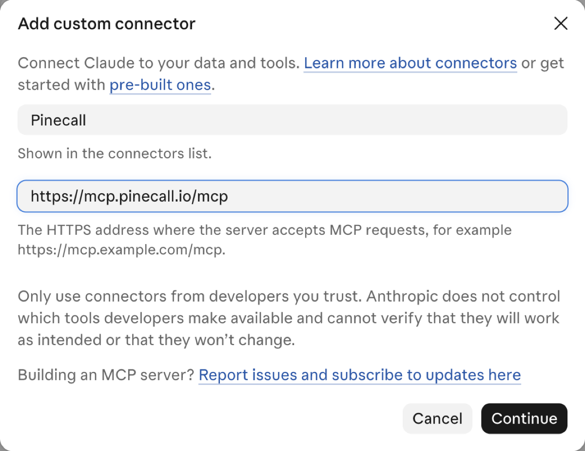
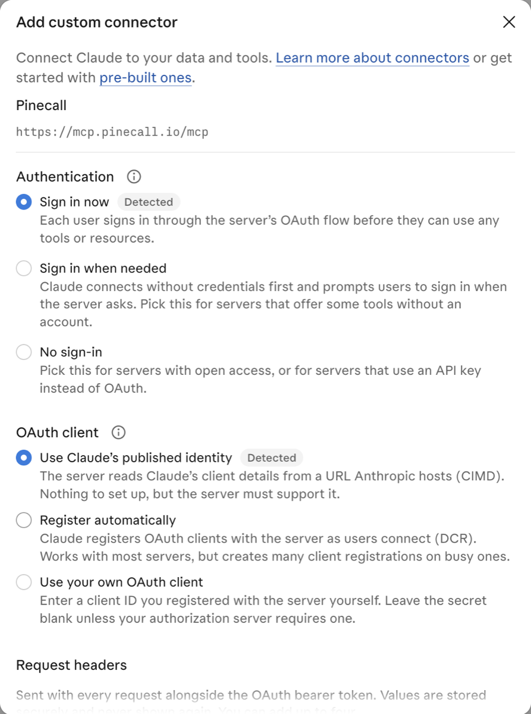
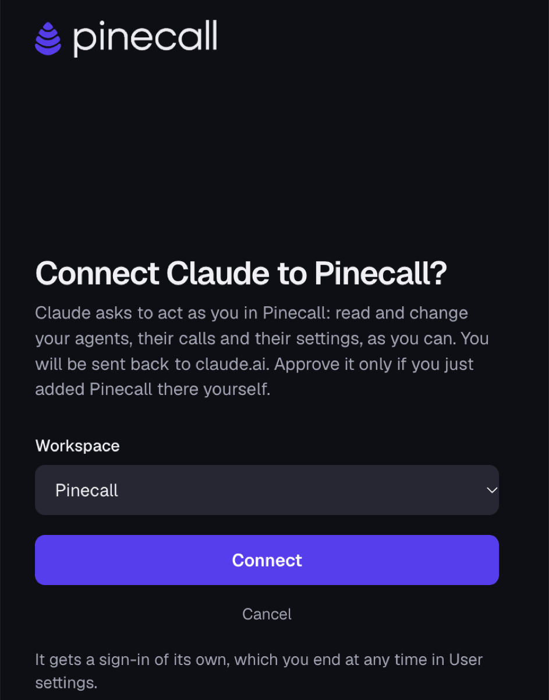
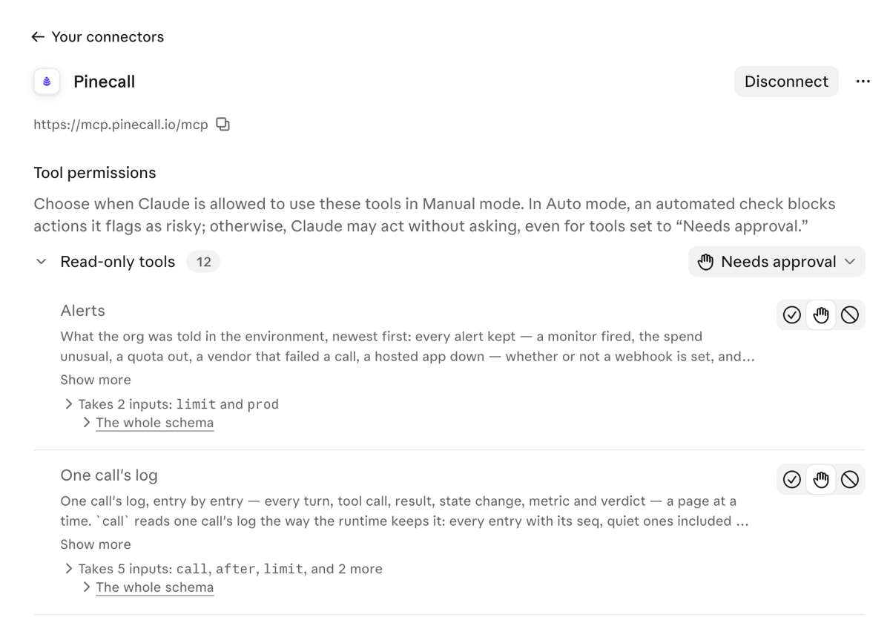
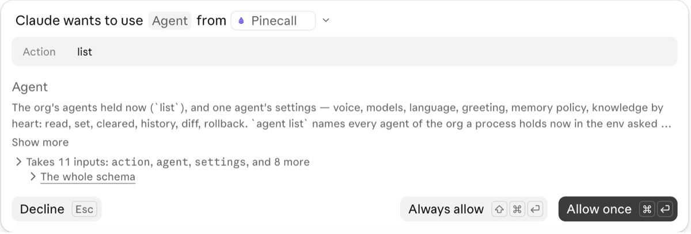
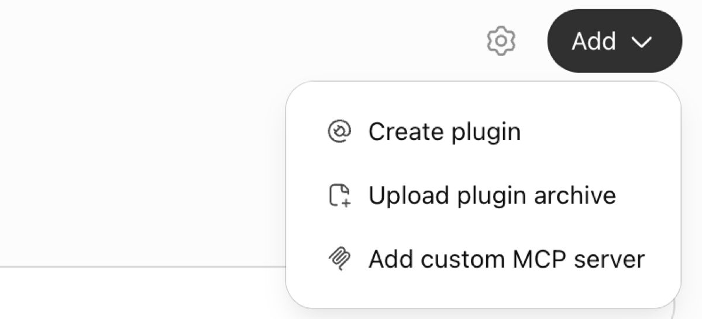
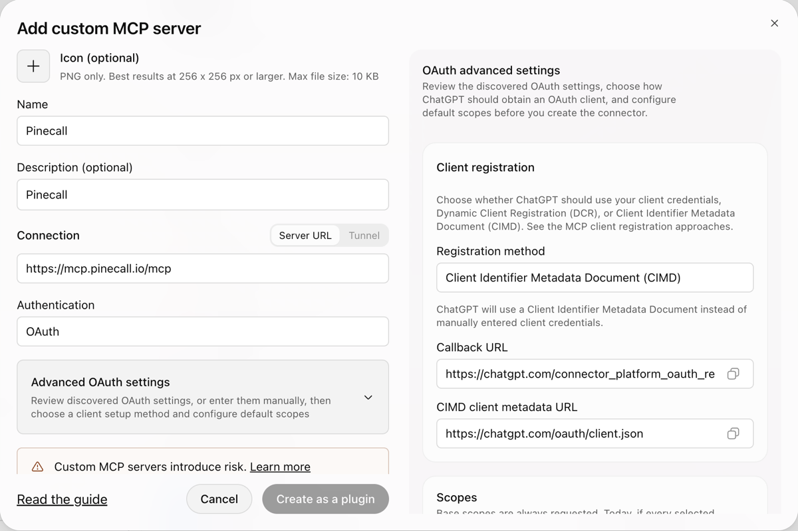
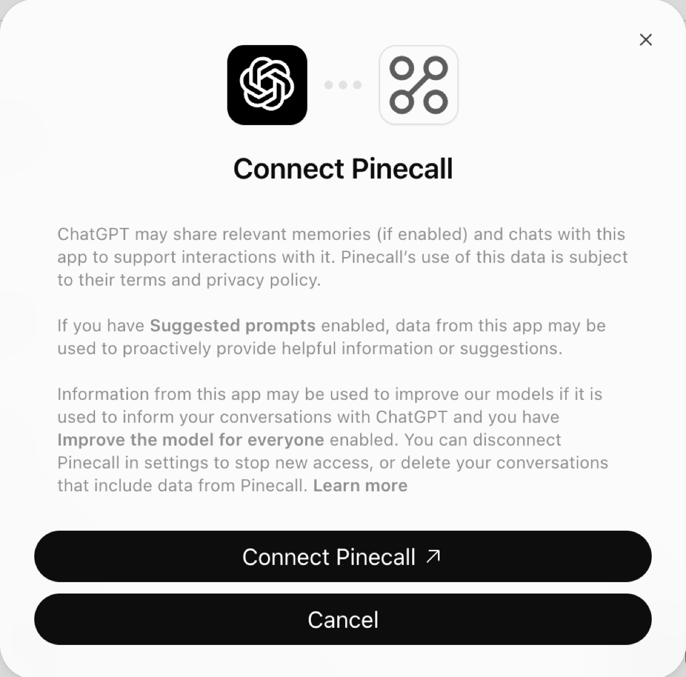
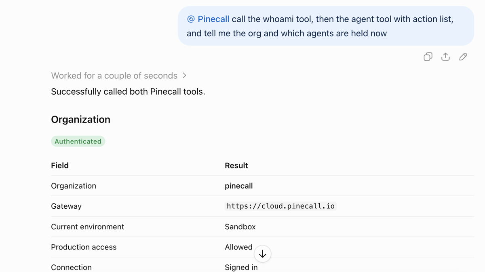

# Connect Claude or ChatGPT

Pinecall's MCP server is hosted at one address:

```
https://mcp.pinecall.io/mcp
```

Add that address to Claude or ChatGPT as a connector, approve it once on a Pinecall page, and the
assistant works in your org: it reads your calls, talks to an agent, changes its voice, runs a
simulation, watches a live call. Nothing is installed and no key is copied. Claude Code, Cursor,
VS Code, Codex and Gemini CLI take the same address, [further down](#claude-code).

## What is a connector?

A connector is a server an assistant calls for tools. You add it once in the assistant's settings;
then, in any conversation, the assistant may call its tools, and asks you first unless you told it
not to. The assistant signs in to Pinecall as you, through a page of Pinecall's own, so it acts with
your role in your org and never sees your password.

The connector added here is yours alone. Listing Pinecall in Claude's or ChatGPT's public directory
is a separate review, and nothing on this page needs it.

## Claude

On claude.ai, in Claude Desktop and in the phone app, on every plan.

:::steps
### Open your connectors

In claude.ai, open **Settings** and then **Customize**. Under **Connectors**, choose the **Yours**
tab, then **+ Add** and **Add custom connector**.

### Name it, and give it the address

Write `Pinecall` as the name and `https://mcp.pinecall.io/mcp` as the MCP server URL, then click
**Continue**.



### Keep what Claude detected

Claude reads from the server how it signs in: **Sign in now** and **Use Claude's published
identity**, both marked *Detected*. Change nothing, scroll down and click **Add**.



### Connect, and approve on Pinecall's page

Click **Connect**. A Pinecall page opens, signed in if your browser already is, or asking you to
sign in first. It names Claude, the workspace it will act in and where it sends you back. Choose the
workspace if you belong to several, and click **Connect**.



:::result
Back in Claude: *Connected to Pinecall.* The connector's page lists its tools, the read-only ones
apart, each one set to *Needs approval* until you choose otherwise.


:::

### Use it in a chat

Ask for something Pinecall knows: *"Which of my agents are running, and how did their last calls
go?"* Claude asks before each tool the first time; **Allow once** runs that call, **Always allow**
stops asking for that tool.


:::

If a chat does not use it, the **+** button at the lower left of the chat lists your connectors:
switch Pinecall on there.

On a Team or Enterprise plan an owner adds it once for everybody, in **Organization settings >
Connectors**; each member then finds it among their connectors and clicks **Connect** to sign in as
themselves.

## ChatGPT

On chatgpt.com, the free plan included. In a workspace, its admin decides whether members may add a
custom MCP server.

:::steps
### Open Plugins, and add a custom MCP server

Open [chatgpt.com/plugins](https://chatgpt.com/plugins). Click **Add**, at the top right, and
choose **Add custom MCP server**.



### Fill in the form

Write `Pinecall` as the name (a description is optional), keep **Server URL** under *Connection* and
enter `https://mcp.pinecall.io/mcp`, and keep **OAuth** as the authentication. ChatGPT finds the
rest from the server itself: open **Advanced OAuth settings** and it shows it registers with its own
client document. Change nothing there.



### Create it

Scroll down, tick **I understand and want to continue** under the warning, and click **Create as a
plugin**.

### Connect, and approve on Pinecall's page

ChatGPT asks to connect Pinecall. Click **Connect Pinecall**: the same Pinecall page as for Claude
opens, naming ChatGPT and sending you back to chatgpt.com. Choose the workspace, and click
**Connect**.



:::result
Back in ChatGPT, Pinecall is under **Installed** on the Plugins page.
:::

### Use it in a chat

Open Pinecall's plugin page and click **Try in chat**, or type **@** in any conversation and pick
Pinecall, then ask.


:::

## What the connection can do

The hosted server has 35 tools: the agents your org runs, their settings, their calls, tests and
cases, simulations, a live call, numbers and the docs. Each says whether it only reads or may change
something, and the assistant shows that: Claude groups the read-only ones apart, and asks before the
others. The destructive ones — placing a call, buying a number, ending a live call, overwriting
settings, removing a judge or a persona — are the ones to keep on *Needs approval*.

It has no folder of yours. What needs your project's files — writing an agent's class, holding it
while you write it, its golden files, uploading a project — is the [MCP server on your
machine](../the-mcp.md), which an assistant on your computer runs (`pinecall mcp install`). A tool
asked for one of those answers in a sentence that says so.

Every tool, its parameters and what it answers: [the tools, stage by stage](../the-mcp.md#the-tools).

## What you approved

The Pinecall page at `https://cloud.pinecall.io/connect` gives the assistant a sign-in of its own:
a key of yours, labelled with the assistant's name.

- **It acts as you.** It opens what your role opens, in the sandbox, and in production when a tool
  is asked with `prod: true` and your org lets you act there.
- **It is listed with your sign-ins.** The console's **User settings** lists it under *Where you are
  signed in*, beside your browsers and terminals. Ending it there cuts the assistant off at once.
- **Disconnecting in the assistant stops the assistant**, but Claude's **Disconnect** leaves the
  sign-in itself in that list. End it in User settings too when you are done with it.
- **It ends by itself** thirty days after the assistant last used it. The assistant then asks you
  to connect again.
- **No key crosses the model.** No tool takes a vendor's key or a secret, and no answer carries a
  Pinecall key.

## Claude Code

```bash
claude mcp add --transport http pinecall https://mcp.pinecall.io/mcp
```

Then, inside Claude Code, type `/mcp`, choose `pinecall` and follow the browser. `claude mcp login pinecall`
does the same from a shell. Add `--scope user` to have it in every project, or `--scope project` to
write it into the repository's `.mcp.json` for your team:

```json
{
  "mcpServers": {
    "pinecall": { "type": "http", "url": "https://mcp.pinecall.io/mcp" }
  }
}
```

## Cursor

In `~/.cursor/mcp.json` for every project, or `.cursor/mcp.json` in one:

```json
{
  "mcpServers": {
    "pinecall": { "url": "https://mcp.pinecall.io/mcp" }
  }
}
```

Cursor shows the server as needing a sign-in: click it, and approve in the browser.

## VS Code

In `.vscode/mcp.json`:

```json
{
  "servers": {
    "pinecall": { "type": "http", "url": "https://mcp.pinecall.io/mcp" }
  }
}
```

Or from the Command Palette: **MCP: Add Server**, then **HTTP**, then the address. VS Code asks
you to sign in the first time the server starts.

## Codex

```bash
codex mcp add pinecall --url https://mcp.pinecall.io/mcp
codex mcp login pinecall
```

On a machine with no browser, `codex mcp login pinecall --no-browser` prints the address to open
and takes the redirect back as text. The same server in `~/.codex/config.toml`:

```toml
[mcp_servers.pinecall]
url = "https://mcp.pinecall.io/mcp"
```

## Gemini CLI

```bash
gemini mcp add --transport http pinecall https://mcp.pinecall.io/mcp
```

Then `/mcp auth pinecall` inside Gemini CLI. The same server in `~/.gemini/settings.json`:

```json
{
  "mcpServers": {
    "pinecall": { "httpUrl": "https://mcp.pinecall.io/mcp" }
  }
}
```

## Any other assistant

Anything that speaks MCP's Streamable HTTP takes the address as it is, and finds the sign-in by
itself. An assistant that can only launch a command reaches it through `mcp-remote`:

```json
{
  "mcpServers": {
    "pinecall": { "command": "npx", "args": ["-y", "mcp-remote", "https://mcp.pinecall.io/mcp"] }
  }
}
```

## With a key, and no browser

A script, a CI job or an agent of your own has nobody to click. The hosted server takes a Pinecall
key as a bearer too: a server's token from the console's **API keys** screen, which acts in the one
environment it was made for.

```bash
claude mcp add --transport http pinecall https://mcp.pinecall.io/mcp \
  --header "Authorization: Bearer $PINECALL_KEY"
```

```toml
# ~/.codex/config.toml
[mcp_servers.pinecall]
url = "https://mcp.pinecall.io/mcp"
bearer_token_env_var = "PINECALL_KEY"
```

Keep the key in the environment or in the assistant's own secret store, never in a file a
repository tracks.

## On a runtime of your own

Every gateway is an OAuth authorization server for its own people: it answers
`/.well-known/oauth-authorization-server`, registers an assistant, and serves the page a person
approves it on. The hosted server is a small service beside it, released from this repository's
chart at a name you choose. [Running it](../../../mcp/README.md).

## Under it

For whoever writes an MCP client, or wonders what the assistant does.

| | |
|---|---|
| transport | Streamable HTTP at `/mcp`: each request whole, answered as JSON, no stream and no session id |
| the sign-in | OAuth 2.1, the authorization code grant with PKCE (`S256`), a public client |
| found by | `401` with `WWW-Authenticate: Bearer resource_metadata=…`, then `https://mcp.pinecall.io/.well-known/oauth-protected-resource` (RFC 9728), then `https://cloud.pinecall.io/.well-known/oauth-authorization-server` (RFC 8414) |
| the client | a Client ID Metadata Document (its `client_id` is the document's `https` address: Claude's and ChatGPT's both are), or registered at `/v1/oauth/register` (RFC 7591) |
| the token | a Pinecall key of the person's, as a bearer. No refresh token: the key is kept while it is used |
| the tools | each with a `title` and `readOnlyHint` or `destructiveHint` |
| revoked by | `POST https://cloud.pinecall.io/v1/oauth/revoke` (RFC 7009), or the person, in the console |

The gateway's side, endpoint by endpoint:
[People](../../../runtime/docs/protocol/people.md#an-app-connected-as-you--v1oauth).

## Next steps

:::cards
- [The MCP server on your machine](../the-mcp.md) {terminal} The same tools, and the ten that need your project's folder.
- [Quickstart](../quickstart.md) {rocket-launch} From nothing to an agent that answers, in ten minutes.
- [The console tour](../../../docs/pages/guides/console-tour.md) {layout} Where the sign-ins are listed, and everything else.
:::
